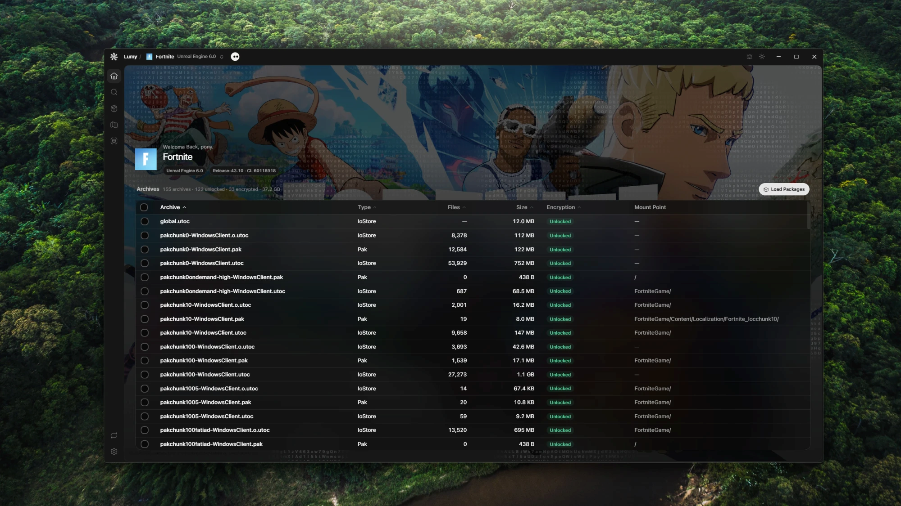

  

<h1 align="center">Lumy</h1>

Explore, preview, and export the files inside Unreal Engine games & More

  
  
  

  

## Download

Download `Lumy.exe` from the [latest release](https://github.com/cloudmilo/Lumy/releases/latest) and run it. It is a single file with nothing to install; put it wherever you like.

Lumy looks for a new version every time it starts. When one is out, a bar at the top of the window offers to update: Lumy downloads it, checks it against the release, and restarts into it. You can also check any time from the sidebar.

## Features

### Games
- Add any Unreal Engine game by choosing its folder. Home lists its archives (.pak and IoStore) with their files, size and encryption.
- Fortnite-Live is built in: browse Fortnite's current build straight from Epic's servers, with nothing installed. Files download as you open them.
- Fortnite's AES keys and mappings load on their own.

### Browse
- Every file of a game in a folder tree, with search across all of them.
- Packages open as highlighted JSON, with links that open the assets they point to.
- Textures, item cards, and cosmetic styles preview next to the JSON.
- Play the game's sounds.
- Export files as JSON, raw data, or PNG images.

### 3D Viewer
- Static and skeletal meshes, and Fortnite characters with their materials, styles, and lobby idle.
- Emotes with their music, sounds, props, and effects on a timeline, group emotes with every member, and faces that move.
- Worlds: maps with their terrain, water, and time of day.
- MSAA, FXAA, TAA, or 2× supersampling.

### Fortnite map
- The Battle Royale map with its named places and characters.

### Appearance
- Light, dark, or blur, which lets your desktop show through.
- Eight palettes, any accent color, JSON colors, row height, and text size.

## Requirements

- Windows 10 or 11, 64-bit.
- Microsoft Edge WebView2 Runtime (already included with Windows 11).

---

More to be added.

