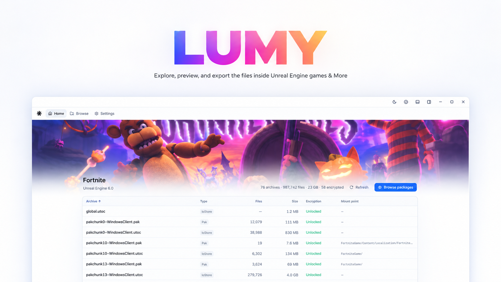

  

<h1 align="center">Lumy</h1>

Explore, preview, and export the files inside Unreal Engine games & More

  
  
  

  

## Download

Download `Lumy.exe` from the [latest release](https://github.com/cloudmilo/Lumy/releases/latest) and run it. It is a single file with nothing to install; put it wherever you like.

Lumy checks for new versions on its own and can update itself.

macOS and Linux test builds are attached to each release too; its notes say how to open them.

## Features

- Browse every archive of a game in a folder tree, and search millions of files instantly.
- Read packages as highlighted JSON, with links that open the assets they point to.
- Preview textures and cosmetics, with their styles, and copy or save them as images.
- Play the game's sounds, and the sound cues and MetaSounds that use them, in a timeline player with a playlist, and save them as WAV. RAD Audio, Bink Audio, Wwise, and more.
- View static and skeletal meshes in the 3D Viewer, with their textures, wireframe, bones, and every level of detail, and save them as glTF, ActorX, or UEFormat with their materials and textures.
- Export files as JSON, raw data, images, or meshes, with progress for large folders.
- Fortnite support out of the box: AES keys, mappings, and on-demand content load automatically.
- Unlock encrypted archives with your own AES keys: archives that share a key, such as a .pak and its .utoc, unlock together, and the key is remembered.
- Browse GTA V's archives (.rpf), AES and NG encrypted, each as a folder of its files, with the AES key from your own GTA5.exe and the NG keys you supply: open its .meta and text files, and save any file decrypted and decompressed.
- Open GTA V's files: texture dictionaries (.ytd) and DDS files as images, sounds (.awc) in the player, encrypted ones too, models (.ydr, .ydd, .yft) in the 3D Viewer with their textures, vehicles with their wheels, collisions (.ybn) and navigation meshes (.ynv) in the 3D Viewer, maps (.ymap), map types (.ytyp), data (.ymt, .ymf), and cutscenes (.cut) as JSON with their names, text tables (.gxt2), path nodes (.ynd) and vehicle and waypoint recordings (.yvr, .ywr) in the 3D Viewer, particle effects (.ypt) with their textures and models, animations (.ycd), scripts (.ysc) with their natives and text, Scaleform movies (.gfx) with their images, Bink videos (.bik) with their audio, and RBF data; save textures as PNG and models as glTF.
- Light and dark themes, accents, and interface scale.

## Requirements

- Windows 10 or 11, 64-bit.
- Microsoft Edge WebView2 Runtime (already included with Windows 11).

macOS 12 or later, and Linux with WebKitGTK, for the test builds.

---

More to be added.

